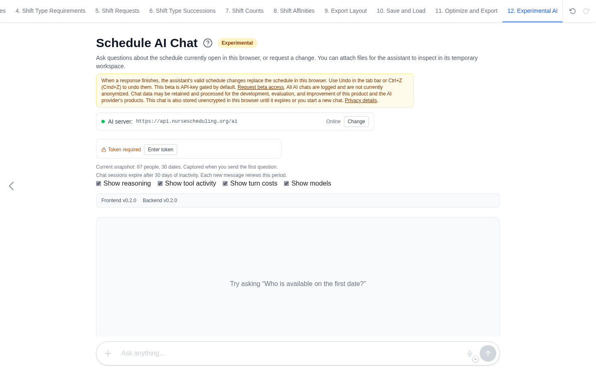

# Experimental AI Chat

[Open Experimental AI](https://nursescheduling.org/experimental-ai){ .md-button .md-button--primary }

!!! warning "Experimental"
    AI answers may be incorrect. Verify them against the schedule before use.

The hosted assistant is an API-key-gated beta. See
[AI Beta Access](https://github.com/j3soon/nurse-scheduling#ai-beta-access)
to request access.

This page answers questions about the schedule currently open in the browser.
A question can include files of any type when **Attach files** is available.
The assistant can inspect common text, image, PDF, and spreadsheet formats in
its temporary workspace. The assistant can change the schedule. A valid change
replaces the schedule in this browser when the response finishes. **Undo** in
the tab bar or <kbd>Ctrl</kbd>+<kbd>Z</kbd> undoes it. The assistant can also run the
optimizer and review its result.

## Build from ward requirements

Use [Build a Real Schedule](build-a-real-schedule.md) for the app workflow and
the 87-person example. If file attachment is available and the source contains
no sensitive data, add the workbook with **Attach files** and ask the assistant
to inspect it. Have it list the
people, dates, staffing levels, requests, history, and any unclear
notation before changing the schedule. A `1`, a color, or a short shift
code can mean different things in different wards. Confirm those meanings and
group memberships with the person preparing the schedule.

Work in stages. First establish staffing, qualifications, required assignments,
and rest rules. Then add nurse requests, monthly shift-team preferences, and
fairness targets. After each change, review its differences in the chat and undo
any change you do not want. Run the optimizer, inspect coverage and the distribution of days off, and
ask for empirical adjustments. Values such as 11 `OFF` days or a particular
weight are examples to tune, not defaults for every ward.

The assistant can inspect an attached workbook and change the schedule,
but it cannot click through the app or run its upload controls for you. Use the
[People](people.md) and [Shift Requests](shift-requests.md) pages for bulk
imports. Follow the [data and limitations](#data-and-limitations) guidance
before attaching any ward records.

## Ask the assistant to optimize

Ask the assistant to optimize the current schedule and describe the result or
improve a specific outcome. The assistant starts the run in the background, so
you can continue chatting while it solves.

- Ask it to **finish now** to request the best solution currently available.
- A small status indicator remains above the message box while optimization is
  running.
- Foreground commands such as `bash` appear in the answer activity. The status
  indicator above the message box is reserved for optimizer runs.
- When the run ends, the chat records its outcome, score, solver and timeout,
  backend URL and version, and any claimed performance. It offers the result
  workbook as a download. The
  assistant receives the score and a copy of the workbook in its workspace. It
  can inspect relevant spreadsheet sections to answer questions about the result,
  including in later chat turns while the result remains available.
- The assistant wakes automatically and replies in a new turn.
- The assistant may change the YAML and run the optimizer again. The changed
  YAML replaces the schedule in the browser when that response finishes.

The optimizer runs for up to 300 seconds (five minutes) by default. Ask the
assistant for a different timeout when needed. A deployment may set another
default. One chat may start 50 optimizer runs by default.

Optimizer completion reports explain when an automatic request audit is unavailable.
Custom export text outside bracketed annotations can prevent the audit.

Before submission to the optimizer, the AI service applies the same basic
anonymization as **Optimize and Export**: it replaces person IDs and removes
description fields. It restores person IDs in the downloaded workbook. Dates,
shifts, groups, and rules can still reveal sensitive information.

Each run uses a server-side schedule snapshot. Editing or undoing the browser
schedule does not interrupt the assistant. Send passes the current browser
schedule to the assistant for your next question.

When you build a new roster, the assistant asks about missing rest and fairness
rules together before creating it. You can decline forbidden transitions, work
streak limits or balancing. It uses answers you already gave.

## Review an applied change

Ask for a change, such as renaming a person or adding a shift request. The
assistant edits a temporary copy of the schedule, and the app checks each edit.

1. Ask for the change in the usual way.
2. Each step that changes the temporary schedule shows **Schedule check passed**
   or **Schedule check failed**. It contains the check result that the assistant
   received. After a failed check, the assistant repairs the problem.
3. When the response finishes, the last valid schedule replaces the schedule in
   this browser. **Applied to your schedule** lists every difference.
   If you changed the browser schedule during the response, a notice explains
   that the assistant replaced those changes.
4. The change is one step in the edit history, so **Undo** or
   <kbd>Ctrl</kbd>+<kbd>Z</kbd> reverts the whole change. The assistant learns about the undo when you send
   your next question.

A change replaces edits that you made elsewhere in the app while the assistant
was answering. Use <kbd>Ctrl</kbd>+<kbd>Z</kbd> to restore them.

## Reconnect or retry

If the model provider has a temporary failure, the assistant retries the current
model request automatically. A notice in the chat shows each retry and its delay.
Retries keep completed tool results and files. They do not rerun completed commands
or optimizer submissions. Partial text remains visible with a note that it is
omitted from future model context. The retry starts a fresh answer to the same
request.

If the provider still fails after five attempts by default, or after two minutes,
the response fails with the provider error. Earlier answers stay in the conversation,
and the AI sees that this response did not finish. To continue, send a new message,
such as "Continue". Files from the failed response are not kept.

The assistant continues working if the browser loses its connection or the phone
sleeps. The chat reconnects automatically and recovers the complete saved answer.
Reloading the same tab also resumes an unfinished request. **Stop** requests
cancellation on the server and waits for its outcome. An answer that completed
before Stop remains a completed answer.

You can switch to another app page while the assistant answers. Returning to
chat resumes the conversation. The app still warns before leaving with unsent
text or selected files.

A failed turn keeps its original question and provisional output visible. To
continue, send a new message. If the files of a question did not finish uploading,
the question was not sent. Attach the files again and send the question. Reconnecting
an accepted request keeps the same message ID, so it does not send the question to
the model twice. Incomplete responses are omitted from future model context.
Completed tool exchanges remain, with a separate note when the temporary workspace
was discarded.

Recovery lasts until the session expires, normally after 30 days of inactivity.
Hosted deployments use PostgreSQL to
recover messages after a backend restart. A restart interrupts active responses,
but the saved question, partial output, uploaded source files, generated ZIPs,
and optimizer files remain available. Removing an upload or ZIP hides it from
active use but keeps it in the session archive. Removed files still count toward
the chat's stored file limit, 1 GB by default. When a chat reaches it, start a
new chat to save more files. All archived files expire with the chat. Without PostgreSQL, chats and files remain in memory only.
Keep your original files.

## See what the assistant did

Choose **Model** before the first message. It stays fixed for the conversation
after the AI service accepts a message. A rejected message does not fix it.
You can change **Reasoning** while an answer streams. The active turn keeps its
original setting, including tool calls and steering. The new reasoning setting
applies to later turns and optimizer reviews. Reloading restores the choice.

**Context X% used** and **Tokens: X / N** below the message box describe the
same current LLM context. X includes system instructions, tools, conversation
messages, and streamed output. N is the model context limit reported by the
provider. The percentage is X divided by N.

The app labels estimates with **(est.)** while streaming and after summarization.
Provider-reported token usage replaces estimates when available. If the model
limit is unknown, the token count remains visible and the percentage shows
**unavailable**. Hover over either value for its description. **Est. cost** is
separate from context usage.

Select **Compact context** below the message box while the assistant is idle to
summarize older conversation context. This action does not generate an answer.
The chat records **You requested context compaction**. **No compaction needed**
means that compaction would not make the context smaller, so it stays unchanged.
Use **Stop** to cancel it. Failed or cancelled compaction keeps the original
context.

When the conversation is summarized, expand **Conversation summarized** to read
the summary sent to the assistant. A discarded summary stays visible and is
marked as omitted from future context. Earlier messages remain in the visible
transcript even when the summary replaces them in model context.

Small grey rows under an answer record how it was produced. They stay collapsed
until you select one.

- **Reasoning** shows the model's own thinking for that step.
- The `bash` tool shows the command the assistant ran and its bounded output.
  The assistant may read task-sized schedule references from the temporary
  sandbox when it needs schema guidance.
- **schedule edit** shows the changed lines after a Bash command changes the
  temporary schedule. Red lines were removed and green lines were added. This
  is a preview. The schedule changes when the response finishes.
- A row marked `failed` means that step changed nothing. This is the usual
reason an answer arrives without a schedule change.
- The `optimizer` tool shows whether the assistant started, checked, or asked
  the current optimization to finish.

Long output is revealed a portion at a time with **Show more**. Clear
**Show reasoning** or **Show tool activity** near the top of the page to hide
either kind. **Show turn costs** controls each reply’s cost summary and call
details. **Show models** controls each reply’s model and reasoning setting.
These choices are remembered on this browser. Exports always include these
details regardless of the display settings. The conversation cost appears as
**Est. cost** beside context usage on one line that wraps when needed.

If a turn fails, read the error beside its response. Chat exports retain that
error with any partial answer. A provider error can include an HTTP status and
an error ID to share when reporting the problem. A schedule
validation error explains the invalid value or field. Failed validation discards
that turn's edits and keeps your current schedule.

## Real scenario example

For the anonymized 87-person ward example, load
`large-ward-with-87-people-2025-11.yaml`, then open **Experimental AI**. Confirm
that the snapshot shows 87 people and 30 dates before asking a question.

The blue development-version banner appears only in non-release builds.

## Ask about a schedule

1. Finish editing or load the intended schedule.
2. Open **Experimental AI**.
3. Confirm the displayed people and date counts.
4. If **Attach files** is available, optionally select files and confirm the
   displayed names. Remove an incorrect file with its **×** button.
5. Enter a question and select **Send**. Press <kbd>Enter</kbd> to send or
   <kbd>Shift</kbd>+<kbd>Enter</kbd> for a new line. Where browser speech
   recognition is available, select the microphone to dictate the question.
   Pasting formatted text converts bold, italics, and links to Markdown in
   the message box. Tables and preformatted blocks use plain text to preserve
   cell separators and indentation. Pasting plain text preserves it as written.
6. While the assistant is working, enter another message and select **Queue**
   to steer the same turn after its next tool call. This does not cancel work
   already in progress.
7. Select **Stop** to interrupt a response in progress.
8. If you scroll up in a long conversation, use the floating down-arrow button
   to return to the composer and latest message.

The animated **Thinking** indicator means the assistant is waiting for its
first response text.

Assistant answers render Markdown, including headings, lists, links, code, and
tables. Use the copy icon at the top-right of a code block to copy its contents.
Raw HTML is ignored. Remote images written in an answer are not loaded.
Uploaded file names and sizes appear beside their upload event in the chat and
exports. The file panel shows the files currently retained by the session.

Use **Export Chat** to download one ZIP from the server. Extract it and open
`chat.html` for a styled transcript or `chat.md` for Markdown. Both link to files
under `attachments/`, including removed uploads, generated ZIPs, and optimizer
files. The ZIP also contains the current `schedule.yaml`, structured `chat.json`,
and `manifest.json` with file origins and hashes. Work still in progress is marked
as unfinished. Export is unavailable on servers without saved chat history.

When the assistant creates files for download, it puts them in one ZIP archive.
Use **Download files (ZIP)** below its answer. The archive and its uncompressed
contents are each limited to 50 MB by default. Downloads remain available while
the chat session exists. Without PostgreSQL, the service memory limit also applies. A workspace path
printed in an answer is not itself a download link.
Use **Remove ZIP** after saving a file you no longer need in the chat. This frees
active download storage and removes that ZIP's download button. With PostgreSQL,
the archived ZIP remains until the chat expires.

## Ask how to use the app

The assistant runs inside the existing Nurse Scheduling app and can explain
which page and visible control to use for a task. For example, ask how to add a
person, upload schedule YAML, configure a rule, or start optimization. It can
guide you through those controls, but it cannot navigate, click, or upload for
you. It can always start optimization itself. An unavailable optimizer API
reports a tool error instead.

Files attached with **Attach files** remain available for later questions in the
same chat. The **Uploaded files** panel lists their names and sizes. Use **Remove**
when a file is no longer needed. Uploading a file with a name already in the list
keeps both files and adds a number to the new name, such as `ward (1).csv`.
The panel sits on the right on large screens and can be collapsed on smaller screens.
To replace the schedule currently open in the app directly, use **Upload** on
**Save and Load**.

The browser uploads one YAML snapshot when it creates the chat session. Later
questions in that session use the same service-held snapshot. The current
browser tab preserves the transcript when you switch pages or reload. A chat
expires after 30 days without a message. Each new message renews that period,
and the page reports when a preserved chat has expired.

## Data and limitations

The complete schedule YAML is sent to the configured AI service and placed in
the assistant's temporary workspace. Relevant schedule content reaches the
model when the assistant inspects it. Uploaded source files stay with the chat
for active use until removed or the session expires. Removed files stay in the
archive until expiry. The service loads active files into each new
workspace. File count and size limits apply to retained uploads. With PostgreSQL,
the service loads saved file contents only when a response uses its workspace.
Without PostgreSQL, their bytes share the service's session memory budget.

Each message uses a fresh temporary virtual machine, not your computer or a
persistent desktop. The service loads the current schedule, relevant references,
and retained uploads into it. Other files created during a response disappear
when that workspace closes. Download generated output with **Download files (ZIP)**.
A chat message can mention a removed file even when it is no longer available.
Upload that source again if a later question needs it. The assistant can
inspect spreadsheet cells, including formulas and last-saved values, or extract
text and render selected PDF pages. Rendered pages and any images the assistant
extracts may be sent to the model when it reads them. File support still depends
on the inspection tools installed in the workspace, and the assistant does not
execute attachments.

AI chats and related data may be logged, retained, and processed for the
development, evaluation, and improvement of this product and the AI provider's
products. The AI model still receives the original schedule when it reads it.
Chats and attachments are not anonymized, and the basic optimizer anonymization
does not make a sensitive schedule safe to submit. Do not submit personal,
confidential, regulated, or otherwise
sensitive information. See the
[privacy policy](https://github.com/j3soon/nurse-scheduling/blob/dev/PRIVACY.md)
for details.

Chat sessions use unguessable identifiers but do not have account
authentication yet. Model answers may be incorrect, so verify them against the
schedule.
