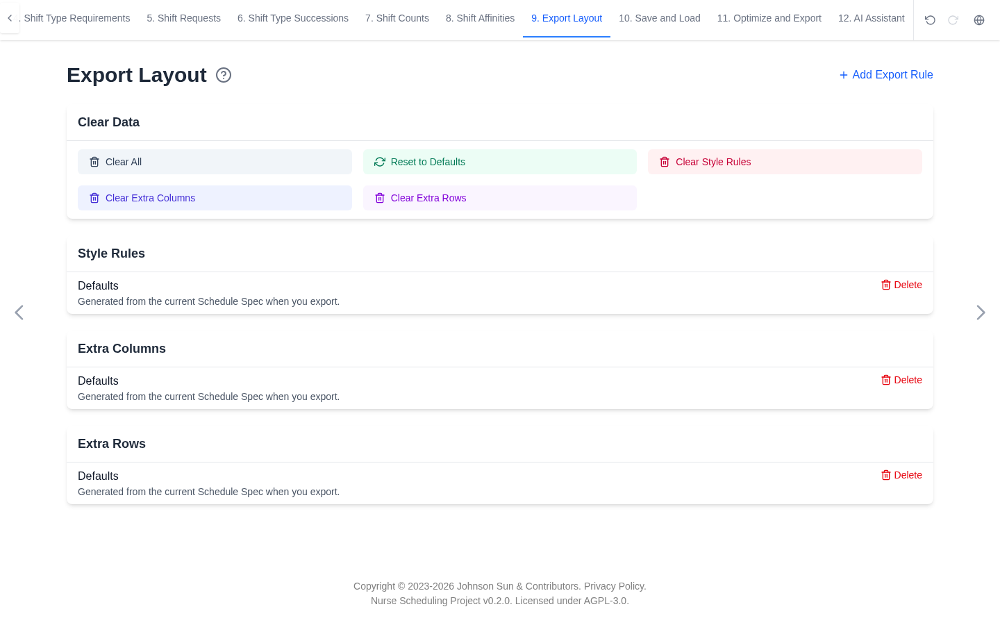

# Export Layout (匯出版面)

[Open Export Layout](https://nursescheduling.org/export-layout){ .md-button .md-button--primary }

Export Layout controls workbook styles and count summaries. Style rules apply
with **Prettify XLSX** on or off. When enabled, **Prettify XLSX** also adds
history, shift request annotations, and count summaries. The default layout
already covers weekends and common counts.

## Real scenario example

The anonymized ward uses the default layout. The workbook highlights
requested and unmet shifts and includes counts for its shift types.

## Customize the layout

- **Style** changes selected cells, rows, columns, or history areas.
- **Extra Column** adds a per-person count over selected dates and shifts.
- **Extra Row** adds a per-date count over selected people and shifts.

Use `#RRGGBB` color values. Count coefficients are optional and default to `1`.
Rules apply in displayed order within each section, so later styles can change
earlier ones. In request annotations, `{shiftType}` uses the original target.
Use `{shortShiftType}` to show `O` for `OFF` when no shift type or group uses
`O` (case-insensitive).

Each section starts with one **Defaults** entry. The workbook generates its
contents from the current Schedule Spec. Select **Add Export Rule** to add a
custom entry, then move it before or after **Defaults**. Put a custom style
after **Defaults** to override a property set by a default style.

Remove **Defaults** to use only your own entries in that section. Select
**Add Defaults** in the section header to restore it. The generated entries
move together and cannot be edited individually.

Renaming or deleting people, dates, or shifts updates references in custom
entries. For example, an **Extra Column** can count one shift across `ALL`
dates for each person.

YAML omits `export` for the default layout. A custom layout can include
`type: defaults` at any position in each list. Within an explicit `export`
mapping, a missing or empty section has no entries.

The solver model is unchanged by export layout rules. Continue with
[Save and Load](save-and-load.md) or [Optimize and Export](optimize-and-export.md).
